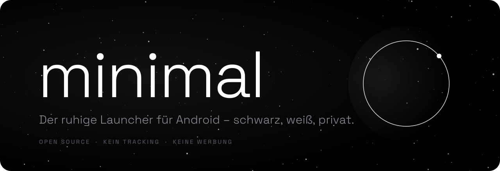
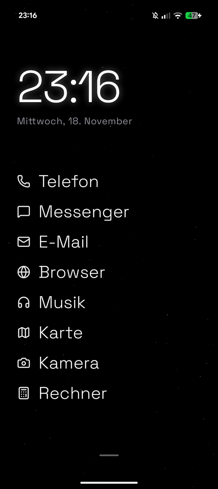
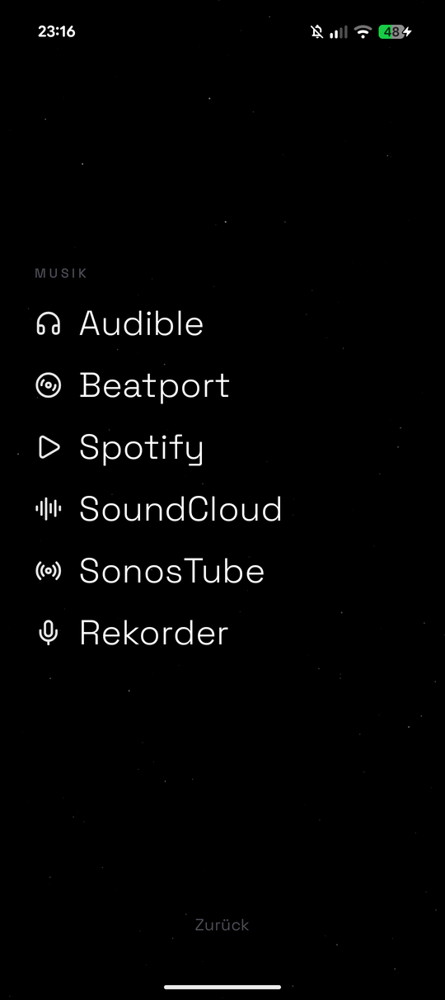
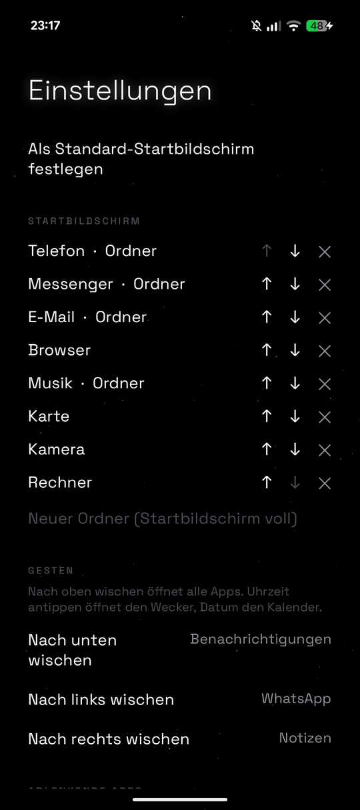

<p align="center">
  
</p>

<p align="center">
  <a href="../../releases/latest/download/Minimal.apk"><b>⬇&nbsp; Neueste Version herunterladen</b></a>
  &nbsp;·&nbsp; <a href="../../releases">Alle Versionen</a>
  &nbsp;·&nbsp; <a href="DATENSCHUTZ.md">Datenschutz</a>
</p>

---

**Minimal** macht dein Android-Handy wieder zu einem Werkzeug statt zu einer Ablenkungsmaschine.
Keine bunten Icons, keine roten Zähler, kein Feed – nur Uhrzeit, deine wichtigsten Apps als Text und eine kleine Pause, bevor du in Instagram & Co. verschwindest.

Die Idee kennt man von minimalistischen Launchern wie *Minimalist Phone*. Minimal ist die **datenschutzfreundliche, quelloffene und kostenlose** Variante davon: kein Konto, kein Abo, keine Werbung, kein Tracking – und jede Zeile Code ist hier nachlesbar.

<p align="center">
  
  &nbsp;
  
  &nbsp;
  
</p>
<p align="center"><sub>Startbildschirm · Ordner · Einstellungen</sub></p>

## Was Minimal kann

**Startbildschirm**
- Große Uhrzeit, Datum, Akku und deine Bildschirmzeit von heute
- Bis zu 8 Lieblings-Apps oder Ordner – nur als Text, auf Wunsch mit schlichtem weißem Symbol davor
- **Ordner** wie „Nachrichten“ mit WhatsApp, Telegram und Signal – auf dem Startbildschirm nur ein Wort, Reihenfolge darin frei wählbar
- Kurzwege: Uhrzeit antippen öffnet den Wecker, Datum den Kalender

**App-Liste**
- Nach oben wischen: alle Apps alphabetisch, die Liste beginnt in der Bildschirmmitte
- **Buchstabenleiste** rechts zum Springen, Suche mit Umlaut-Toleranz („ö“ findet „o“), Enter öffnet den ersten Treffer
- Ganz oben weiter nach unten ziehen schließt die Liste wieder
- Apps **umbenennen**, **ausblenden** (wahlweise abgedunkelt trotzdem anzeigen) oder deinstallieren

**Weniger Ablenkung**
- Apps als **ablenkend** markieren: Sie erscheinen grau, und vor dem Öffnen kommt eine **Pause** (5–30 Sek.) mit Atem-Ring und deiner heutigen Nutzungszeit
- Bildschirmzeit direkt auf dem Startbildschirm – ganz ohne Cloud

**Aussehen**
- Reines Schwarz (schont OLED-Akkus), weiße Schrift, 186 weiße Linien-Symbole zum Zuordnen
- Leiser Sternenhimmel: bewegt, ruhig oder aus – beim Scrollen ziehen die Sterne auf Wunsch sanft mit (aus / sehr langsam / langsam / normal)
- 3D-Walzen-Effekt in der App-Liste, weiche Übergänge, Schrift *Space Grotesk*, System oder Mono in drei Größen

**Gesten**

| Geste | Wirkung |
|---|---|
| Nach oben wischen | Alle Apps |
| Nach unten / links / rechts wischen | frei belegbar: Benachrichtigungen, eine App oder nichts |
| Lange auf den Startbildschirm drücken | Einstellungen |
| Lange auf eine App drücken | Startbildschirm, Ordner, Symbol, umbenennen, ausblenden, ablenkend, App-Info, deinstallieren |
| Lange auf einen Ordner drücken | Öffnen, umbenennen, Symbol, auflösen |

## Datenschutz

Minimal sammelt **nichts**. Keine Analyse-Werkzeuge, keine Werbe-IDs, keine Absturzberichte an Dritte, kein Konto.

- Alle Einstellungen und die Bildschirmzeit bleiben **auf deinem Handy**.
- Die **einzige** Internetverbindung: höchstens alle 6 Stunden eine Anfrage an die GitHub-API, ob es eine neuere Version gibt. Dabei sieht GitHub deine IP-Adresse – sonst nichts.
- Der komplette Quellcode liegt in diesem Repository; jede APK wird öffentlich nachvollziehbar von GitHub Actions gebaut.

Alle Details und jede Berechtigung erklärt: **[DATENSCHUTZ.md](DATENSCHUTZ.md)**

## Installieren

1. Auf dem Handy **[Minimal.apk](../../releases/latest/download/Minimal.apk)** herunterladen.
2. Antippen – Android fragt einmal, ob der Browser „unbekannte Apps installieren“ darf. Erlauben, installieren.
3. **Home-Taste** drücken und **Minimal** als Standard wählen (oder in Minimal: Einstellungen → „Als Standard-Startbildschirm festlegen“).
4. Optional für die Bildschirmzeit: Einstellungen → Aussehen → **Nutzungszugriff erlauben**.

Neue Versionen meldet Minimal selbst und installieren sich über die alte – alle Einstellungen bleiben erhalten.

> Zurück zum alten Launcher? Android-Einstellungen → Apps → Standard-Apps → Startbildschirm-App.

## Selbst bauen

Kotlin und Jetpack Compose (ohne Material-Bibliothek), minSdk 26 (Android 8), targetSdk 35.

```bash
gradle assembleRelease      # Gradle 8.11, JDK 17, Android SDK 35
```

Jeder Push auf `main` baut per GitHub Actions eine signierte APK und veröffentlicht sie als Release. Der Signierschlüssel liegt als Secret `KEYSTORE_B64`; ohne ihn entsteht ein unsignierter Testbuild. Schlägt ein Build fehl, landet das Log im Branch `build-log`.

```
app/src/main/java/de/philipdecker/minimal/
├─ MainActivity.kt   Navigation, Übergänge, Update-Prüfung
├─ Ui.kt             Startbildschirm, App-Liste, Ordner, Pause, Einstellungen
├─ Data.kt           Apps, Einstellungen, Bildschirmzeit, Kurzwege
├─ Space.kt          Schriften, Sternenhimmel
├─ Glyphs.kt         Symbole (Daten in GlyphData.kt, erzeugt von scripts/icons.py)
```

## Danksagung

- Schriften: [Space Grotesk](https://github.com/floriankarsten/space-grotesk) und [JetBrains Mono](https://github.com/JetBrains/JetBrainsMono) – SIL Open Font License
- Symbole: [Lucide](https://lucide.dev) – ISC-Lizenz
- Lizenztexte in [`licenses/`](licenses)

## Lizenz

[MIT](LICENSE) © Philip Decker

<sub>Minimal ist ein unabhängiges Projekt und steht in keiner Verbindung zu „Minimalist Phone“ oder dessen Anbietern.</sub>
